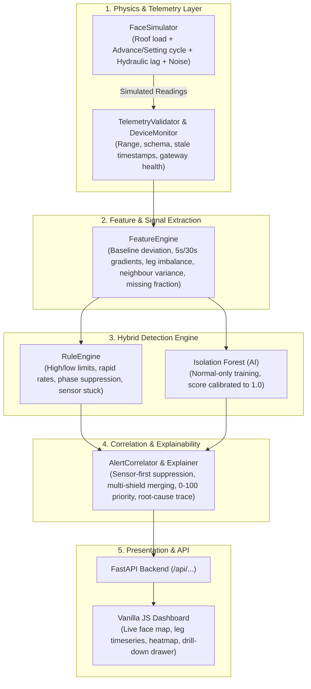

<div align="center">

# 🛡️ MineShield AI
### Intelligent IoT Monitoring & Explainable Anomaly Detection for Longwall Roof Support Shields

[](https://python.org)
[](https://fastapi.tiangolo.com)
[](https://scikit-learn.org)
[](tests)
[](data/eval_results.json)
[-orange?style=for-the-badge)](#disclaimer)

<p align="center">
  <b>A hybrid, physics-grounded AI surveillance system designed to safeguard underground coal mining operations.</b><br>
  Detects roof weighting, hydraulic failures, and sensor dropouts in real-time with explainable, evidence-backed root cause analysis.
</p>

[Key Features](#-key-features) •
[Architecture](#-system-architecture) •
[Benchmark Evaluation](#-benchmark-results) •
[Quick Start](#-quick-start) •
[Demo Guide](#-interactive-demo-guide) •
[Project Structure](#-project-structure)

</div>

---

> [!WARNING]
> **Safety & Research Disclaimer:**  
> This prototype uses simulated telemetry and simplified engineering models ($F = P \times A$). It is an academic/engineering research prototype and **not a certified mining safety system**. It does not establish the absolute probability of roof collapse and must **not** be used to authorize live mining operations or replace certified intrinsically safe equipment (DGMS / IECEx) and standard approved procedures.

---

## 📌 Overview & Motivation

Longwall coal mining relies heavily on massive hydraulic shield supports to hold the strata while shearers extract coal. Shield failure or unpredicted roof-weighting events can trigger catastrophic cave-ins, equipment burial, and severe hazards.

Traditional monitoring relies on simplistic fixed-pressure thresholds (e.g., alert if $P > 380 \text{ bar}$) or rolling statistical deviations. These approaches suffer from:
1. **High false alarm rates** caused by ordinary shield advance and setting cycles.
2. **Blind spots** to slow leakages, canopy leg imbalances, and severe sensor/gateway malfunctions.
3. **No explainability** or root-cause disambiguation between geological pressure changes and physical sensor faults.

**MineShield AI** solves this through a **three-tier hybrid detection engine**:
* **Layer 1: Domain-Engineered Rules** — Phase-aware checks (advance, setting, loaded) that suppress alerts during standard shield moves.
* **Layer 2: Calibrated Machine Learning (Isolation Forest)** — Unsupervised anomaly scoring trained exclusively on normal operating cycles.
* **Layer 3: Sensor-vs-Process Correlator** — Distinguishes genuine strata pressure changes from sensor freezes, drops, or telemetry disconnects, producing human-readable causal explanations.

---

## ⚡ Key Features

- **🏎️ Sub-Second Ingestion & Real-Time Monitoring:** Handles multi-channel telemetry ($12\text{ shields} \times 2\text{ to }4\text{ hydraulic legs}$) with strict schema validation.
- **🧠 Hybrid AI + Domain Detection:** Combines physical boundary rules with a calibrated Isolation Forest model (calibrated so $1.0 = \text{threshold}$).
- **🔍 Explainable AI (XAI) with Evidence Tracing:** Every alert is accompanied by raw sensor values, fired rules, feature contributions, and neighbouring shield comparisons.
- **🛡️ Sensor-Fault Disambiguation:** Hardware failures (stuck sensors, electrical spikes, packet dropouts) are flagged as maintenance items rather than false roof-weighting crises.
- **🎮 Interactive Simulation & Fault Injection:** Built-in engine to inject 9 distinct fault scenarios into the live stream on demand.
- **📊 Zero-Dependency Vanilla Dashboard:** Lightweight, responsive web interface built with vanilla JavaScript and hand-crafted SVG charts (no bulky frontend node dependencies).
- **🧪 100% Offline & Fully Reproducible:** Runs with deterministic random seeds and zero cloud or paid API requirements.

---

## 🏗️ System Architecture



---

## 🏆 Benchmark Results

MineShield was evaluated on a strictly held-out synthetic test suite (**16 episodes of 30 minutes, 48 injected events, seeds 3000–3015**, completely isolated from training and tuning seeds):

| Method | Precision | Recall | F1 Score | False Alerts / hr | Median Delay |
|:---|:---:|:---:|:---:|:---:|:---:|
| **Fixed Threshold** ($380 / 150 \text{ bar}$) | 100.0% | 25.0% | 0.400 | **0.00** | 54 s |
| **Rolling MAD** (Robust $z > 6$) | 100.0% | 27.1% | 0.426 | **0.00** | 122 s |
| **Isolation Forest Only** | 91.9% | 50.0% | 0.648 | 0.38 | 34 s |
| 🛡️ **MineShield Hybrid (Rules + AI)** | **91.5%** | **100.0%** | **0.956** | **0.62** | **4 s** |

### Key Diagnostic Insights:
* **100% Event-Level Recall:** The hybrid system caught all 48 benchmark events without missing a single scenario.
* **100% Category Classification Accuracy:** Perfect disambiguation across all events ($28/28$ Process, $15/15$ Sensor, $5/5$ Telemetry).
* **Rapid Detection:** Median alert latency of just **4 seconds** (compared to 54s for fixed thresholds and 122s for rolling MAD).

---

## 🕹️ Supported Injected Fault Scenarios

The simulator provides 9 built-in fault profiles to stress-test detection pipelines:

| Category | Event Type | Description | System Response |
|:---|:---|:---|:---|
| **Process** | `gradual_rise` | Progressive roof pressure loading | Persistent deviation alert |
| **Process** | `pressure_spike` | Sudden strata impulse | Rapid rise rate limit trigger |
| **Process** | `leakage` | Hydraulic leg fluid decay | Leg-imbalance & negative gradient detection |
| **Process** | `leg_imbalance` | Unequal roof load distribution | Inter-leg delta threshold alert |
| **Process** | `multi_shield_loading` | Wide-area weighting across neighbouring shields | Multi-shield correlation alert |
| **Sensor** | `sensor_spike` | Electrical/transient single-step spike | Sensor anomaly flag (process rules suppressed) |
| **Sensor** | `sensor_stuck` | Sensor line freezes at constant value | Sensor zero-variance flag |
| **Sensor** | `sensor_dropout` | Missing telemetry packets | Data quality penalty & dropout alert |
| **Telemetry**| `telemetry_interruption`| Complete gateway communications failure | Gateway offline warning, state marked unobserved |

---

## 🚀 Quick Start

### Prerequisites
* **Python 3.11+** (Tested on Python 3.12 and 3.13)
* No external databases or node.js build tools required.

### 1. Clone & Set Up

```bash
git clone https://github.com/srijan-0-7/MineShield-AI.git
cd MineShield-AI
```

### 2. Install Dependencies

```bash
pip install -r requirements.txt
```

### 3. Run the Server

```bash
python run.py
```
> *On the very first launch, the anomaly model trains on synthetic normal-only data in ~20 seconds and caches to `data/model.pkl`.*

Open your browser at **[http://127.0.0.1:8000](http://127.0.0.1:8000)** (or run with `--port 8001` if port 8000 is occupied).

---

## 🧪 Testing & Verification

MineShield includes an extensive automated verification suite:

```bash
# 1. Run all 191 unit and integration tests
python -m pytest tests -q

# 2. Run the held-out benchmark evaluation (~60s)
python -m mineshield.evaluation

# 3. Repeat the AI threshold and persistence parameter sweep (~5min)
python -m mineshield.tuning
```

---

## 🎯 Interactive Demo Guide

1. **Start the simulation:** Open the dashboard, set simulation speed to **`20x`**, and click **Start**.
2. **Observe normal cycle:** Notice shields transitioning between *advancing* (grey bar), *setting* (~250 bar), and *loaded* (~320 bar).
3. **Inject a Hydraulic Leak:**
   - Go to **Inject event** $\rightarrow$ select *Leakage-like pressure drop* on `S07`, leg `L2`.
   - Within ~20s, `S07` highlights in red, and an alert is generated.
4. **Inspect the Explainability Drawer:**
   - Click the alert card. Notice the detailed trace: observed values vs. thresholds, AI score, leg imbalance percentage, and verification checklist.
   - Click **"Reveal ground truth"** to confirm the diagnosis against the injected event.
5. **Inject a Sensor Fault:**
   - Select *Sensor stuck at constant value* on `S03`.
   - Observe that the alert is categorized as **Sensor (purple)** rather than a false roof-collapse emergency.

---

## 📂 Project Structure

```
MineShield-AI/
├── config/
│   └── default.json          # Engineering thresholds, physical parameters, simulator bounds
├── data/
│   ├── eval_results.json     # Held-out benchmark metrics and confusion data
│   ├── model.pkl             # Cached Isolation Forest anomaly model
│   └── tuning_results.txt    # Grid sweep results on tuning seeds
├── docs/
│   ├── API_CONTRACT.md       # REST API endpoint schema and specifications
│   ├── DEMO_SCRIPT.md        # Step-by-step 3-5 minute live demonstration script
│   └── MODEL_SPEC.md         # Equations, feature definitions, and evaluation protocol
├── frontend/                 # Zero-build vanilla web interface
│   ├── index.html            # Main dashboard markup
│   ├── styles.css            # Responsive dark/industrial styling
│   ├── app.js                # UI state management and polling loops
│   ├── charts.js             # High-performance hand-written SVG charting
│   └── api.js                # Fetch client for backend endpoints
├── mineshield/               # Core Python package
│   ├── alerts.py             # Alert correlation, priority ranking, and explainability
│   ├── api.py                # FastAPI endpoints and static file mounts
│   ├── config.py             # Configuration loader
│   ├── engine.py             # Core real-time coordinator
│   ├── evaluation.py         # Evaluation benchmark suite
│   ├── features.py           # Feature engineering and rolling statistics
│   ├── model.py              # Calibrated Isolation Forest anomaly detector
│   ├── physics.py            # Shield force calculations (F = P x A)
│   ├── rules.py              # Domain engineering rules
│   ├── simulator.py          # Longwall face synthetic data generator
│   ├── telemetry.py          # Ingestion validation and gateway monitoring
│   └── tuning.py             # Anomaly threshold optimization
├── tests/                    # 191 unit and integration tests
├── requirements.txt          # Minimal production dependencies
├── run.py                    # Server launcher
└── README.md
```

---

## 📐 Engineering Physics & Parameters

* **Force Equation:** $F = P \times A$
* **Bore Diameter:** $0.32 \text{ m} \implies \text{Piston Area } A = 0.0804 \text{ m}^2$
* **Nominal Loading:** $300 \text{ bar} \approx 2.41 \text{ MN}$ per leg.
* **Operating Limits:**
  * Setting Pressure: $250 \text{ bar}$
  * High Pressure Warning: $380 \text{ bar}$
  * Yield Valve Cap: $420 \text{ bar}$
  * Low Pressure Boundary: $150 \text{ bar}$
  * Sensor Range: $0 - 600 \text{ bar}$

---

## 📄 License

This project is released under the **MIT License**. See [LICENSE](LICENSE) for details.
